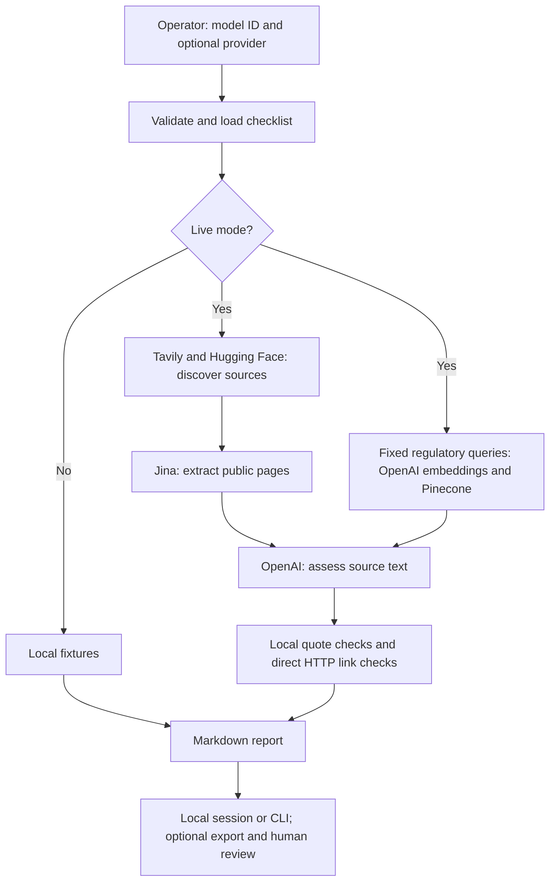

# Lab proof: GDPR self-audit of Model Intake Brief

**Reviewer entry point.** This submission audits the actual local educational project, not a hypothetical deployed client system. Assessment date: 17 November 2026. Source commit: `e384f3a41b5c74119786f55865ebe4e7e6cfb73c`.

**Result:** proceed with conditions for local educational use. Offline fixtures and screened non-personal documents can support learning; unreviewed personal-data flows and external/client deployment remain gated by minimisation, legal/vendor verification and operational accountability. This is not legal certification.

## Deliverables and reading order

1. [Data processing brief](model-intake-data-processing-brief.md): compact DPO handover answering all six kick-off questions.
2. [GDPR worksheet](model-intake-gdpr-assessment.md): Phases 1–5, purpose-specific inventory and LIAs, nine-criterion DPIA screen, rights, law stacking and release gates.
3. [Client compliance memo](model-intake-compliance-memo.md): Phase 6, 300–400 words, addressed to a prospective client's DPO/legal counsel; no actual client is claimed.
4. [Accountability and design checklist](model-intake-accountability-and-design.md): reinforce and stretch exercises.
5. [Evidence and sources](model-intake-evidence-and-sources.md): pinned code links, owner confirmations, legal sources and course-material differences.

## Code and workflow

The [reviewed code](https://github.com/s-rostovskyi/model-intake-brief/tree/e384f3a41b5c74119786f55865ebe4e7e6cfb73c) remains in the original repository. The lab does not duplicate an unrelated application checkout.



Personal information is **possible** in identifiers, public source text and citations; the regulatory branch is non-personal content in the inspected implementation. [Code-to-finding mapping](model-intake-evidence-and-sources.md#code-evidence-register).

## Actual run, input, evidence and final output

The included [reproduction script](evidence/reproduce_privacy_checks.py) imports the unchanged project and blocks HTTP requests and socket connections. It uses no `.env` values or live credentials and writes evidence only to the requested output directory.

Run from this lab folder using the project's installed environment; replace the checkout path as needed:

```powershell
& '<MODEL_INTAKE_CHECKOUT>/.venv/Scripts/python.exe' -B ./evidence/reproduce_privacy_checks.py --project '<MODEL_INTAKE_CHECKOUT>' --out ./evidence
```

| Check | Input | Actual evidence | Final output / meaning |
|---|---|---|---|
| Offline graph run | `{"live_mode": false, "provider": null, "model": "Qwen/Qwen3-8B"}` | 18 findings, all `Not checked`, no run error | [Complete Markdown report](evidence/offline-qwen3-8b-report.md); validates workflow/output, not live model compliance |
| Invalid-input run | CLI arguments `run --model not-a-valid-id` | Exit code 2; format guidance; no report | Controlled failure recorded in [results JSON](evidence/privacy-check-results.json) |
| Synthetic privacy probe | `Example model documentation. Contact: Audit Example, audit.person@example.invalid.` | Prepared LLM prompt retains contact; `store` is false | [Captured outbound body](evidence/synthetic-outbound-payload.json), intercepted locally; proves a minimisation gap, not an actual vendor disclosure |

All results are in [privacy-check-results.json](evidence/privacy-check-results.json). Python version and audited commit are recorded there. The mock LLM response is deliberately not represented as a live successful assessment.

## Failure or limitation encountered

The invalid identifier fails with the expected format error. More importantly for GDPR, the synthetic probe exposes a missing privacy control: the current prompt builder forwards incidental contact text without minimising it. The corresponding remedial action is **G1** in the worksheet.

Offline execution cannot establish vendor retention, accepted DPA terms, physical processing locations, consent compliance or historical personal-data use. These remain explicit unknowns; no paid live run or account inspection was performed. Producing this lab does not implement its recommended controls or complete a DPIA.

## Rubric coverage

| Rubric # | Evidence in submission |
|---|---|
| 1 | Worksheet: scope, findings, recommendation |
| 2 | Processing brief; inventory and role/transfer maps |
| 3 | Worksheet G1–G6; synthetic payload evidence |
| 4 | Client compliance memo |
| 5 | Processing brief: data, source, purposes, processors, locations, decisions |
| 6 | Phase 1: category/purpose rows and secondary-use flags |
| 7 | Phase 2: each entity, conditional role, DPA status and transfer route |
| 8 | Phase 3: per-purpose basis, one-line reasons and all three LIA parts |
| 9 | Phase 4: Article 9, Article 22, all nine DPIA criteria and rights friction |
| 10 | Phase 5: AI Act, ePrivacy and Data Act |
| 11 | 300–400-word memo: bottom line, three sequenced actions, residual risks and disclaimer |
| 12 | Phase 1 personal data inventory |
| 13 | Phase 2 role map |
| 14 | Phase 3 lawful basis assessment |
| 15 | Phase 4 risk and rights analysis |
| 16 | Phase 5 law stacking |
| 17 | Phase 6 client memo |

This is a coverage map, not an awarded grade. Original instructions and rubric remain unchanged. Commit, push and PR submission require the owner's separate confirmation.
